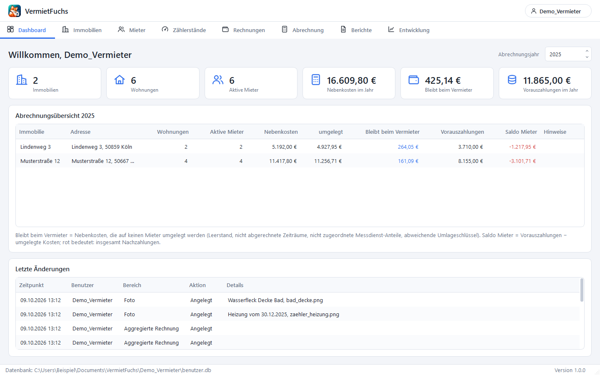

<p align="center"></p>

# VermietFuchs

Desktop-Software zur Verwaltung und Abrechnung von Nebenkosten für Mietwohnungen - für private
Vermieter mit einem oder wenigen Häusern. Kostenlos und quelloffen (GPL v3).
Python 3.11+ · PyQt6 · SQLite · ReportLab · alle Daten bleiben lokal auf dem eigenen Rechner.

> **Keine Rechtsberatung.** Die Software rechnet nach den Angaben, die Sie eintragen. Ob eine
> Abrechnung den gesetzlichen und mietvertraglichen Anforderungen genügt, müssen Sie selbst
> prüfen (oder prüfen lassen). Nutzung auf eigene Verantwortung, ohne Gewähr - siehe
> [Lizenz](#9-lizenz-und-haftung).

## Download (Windows)

Die fertige Anwendung gibt es unter **Releases** als ZIP-Datei - eine Python-Installation ist
dafür nicht nötig:

1. ZIP herunterladen und in einen Ordner entpacken, in dem Sie schreiben dürfen (z. B. unter
   *Dokumente* - nicht unter *Programme*).
2. `VermietFuchs.exe` starten und einen Benutzer anlegen.

Beim ersten Start meldet Windows SmartScreen einen „unbekannten Herausgeber", weil die Datei
nicht kostenpflichtig signiert ist: **Weitere Informationen → Trotzdem ausführen**.
Ihre Daten liegen in der Datei `benutzer.db` am Speicherort, den Sie beim Anlegen des Benutzers
wählen - nicht im Programmordner. Ein Update ist deshalb einfach: neuen Ordner entpacken und
die `config.json` aus dem alten hineinkopieren (sie enthält nur die Liste der Benutzer).



Weitere Screenshots liegen in [docs/screenshots](docs/screenshots), ein Beispiel-PDF unter
[docs/Beispiel_Nebenkostenabrechnung.pdf](docs/Beispiel_Nebenkostenabrechnung.pdf).

---

## 1. Einrichtung (einmalig bei Verwendung des Source Codes - nicht nötig bei Verwendung der Release .exe-Datei)

### 1.1 Python installieren

Python **3.11 oder neuer** (64-bit) von <https://www.python.org/downloads/windows/> installieren.
Im Installer das Häkchen **„Add python.exe to PATH"** setzen.

> Dieser und die folgenden Abschnitte 1–4 betreffen nur, wer am Quellcode arbeiten oder die
> `.exe` selbst bauen möchte. Zum bloßen Benutzen genügt der Download oben.

### 1.2 Virtuelles Environment anlegen

In PowerShell im Projektordner:

```powershell
python -m venv .venv
.venv\Scripts\python.exe -m pip install -r requirements-dev.txt
```

`requirements.txt` enthält nur die Laufzeit-Pakete (PyQt6, ReportLab),
`requirements-dev.txt` zusätzlich pytest und PyInstaller.

## 2. Starten

```powershell
.venv\Scripts\python.exe main.py
```

Beim ersten Start ist die Benutzerliste leer: **„Neuer Benutzer …"** wählen, Namen und
Speicherort angeben - die Anwendung legt `<Speicherort>\<Name>\benutzer.db` an.

### Demo-Daten zum Ausprobieren

```powershell
.venv\Scripts\python.exe -m tools.demo_data "$env:USERPROFILE\Documents\VermietFuchs"
```

Legt den Benutzer `Demo_Vermieter` mit zwei Häusern, sieben Mietern (inkl. Mieterwechsel und
Leerstand), Zählerständen, Kosten und Vorauszahlungen für das Vorjahr an.

## 3. Tests

```powershell
.venv\Scripts\python.exe -m pytest
```

369 Tests: Value Objects, Kostenverteilung (reine Rechenlogik), Kostenarten-Katalog und
Schema-Migration sowie Integrationstests über Services + Repositories + SQLite (Audit Trail,
Transaktionssicherheit, PDF-Export, Benutzerverwaltung, Performance mit 150 Wohnungen).
Das Auslesen von Belegen ohne KI wird mit erfundenen Versorgerrechnungen (PDF-Text und typische
Lesefehler der Texterkennung) getestet, die KI-Belegerkennung gegen einen nachgebauten Ollama-Dienst.
`tests/test_ui_dialogs.py` baut alle Tabs und Dialoge ohne sichtbares Fenster auf und prüft
Duplizieren und Drag-and-drop.
`tests/test_external_templates.py` vergleicht 15 Datensätze mit den Ergebnissen zweier fremder
Excel-Vorlagen (Flächen- und Personenschlüssel, Leerstand, Heizkosten 50–70 %).
`tests/test_reference_billing.py` rechnet eine reale, anonymisierte Jahresabrechnung mit
Mieterwechsel, Messdienst-Beträgen, Wasserzählern und Rechnungen über den Jahreswechsel nach.

## 4. `.exe` erstellen

```powershell
.\build_exe.bat
```

Ergebnis: der Ordner `dist\VermietFuchs` mit der `VermietFuchs.exe` und ihren
Bibliotheken sowie dieselben Dateien als `dist\VermietFuchs-<Version>-windows.zip` zum
Weitergeben. Der Ordner kann an einen beliebigen Ort kopiert werden; `config.json` und der
Ordner `logs` entstehen beim ersten Start **neben der .exe**. Was das Skript tut, steht
kommentiert in [build_exe.bat](build_exe.bat).

Bewusst ein Ordner statt einer einzelnen `.exe`: Eine Einzeldatei müsste sich bei jedem Start
erst in einen temporären Ordner entpacken - das dauert und wird von Virenscannern häufiger
fälschlich gemeldet.

**Neue Version veröffentlichen.** Die Versionsnummer steht in `config.py` (`APP_VERSION`) und
in `pyproject.toml`. Nach dem Anheben und Committen genügt ein Tag:

```powershell
git tag v1.1.0
git push origin main --tags
```

GitHub baut daraufhin automatisch die `.exe` (Workflow `.github/workflows/release.yml`): Tests
laufen, die ZIP-Datei wird erzeugt und an das Release der Version gehängt. Passt der Tag nicht
zur Versionsnummer im Code, bricht der Workflow mit einem Hinweis ab.

App-Symbol und Logo entstehen aus den Originalbildern in `pictures/`:

```powershell
.venv\Scripts\python.exe -m tools.make_assets
```

Die Screenshots lassen sich jederzeit neu erzeugen:

```powershell
.venv\Scripts\python.exe -m tools.make_screenshots
```

---

## 5. Bedienung in Kürze

| Tab | Zweck |
|---|---|
| **Dashboard** | Kennzahlen und Jahresübersicht je Immobilie: Kosten, umgelegt, was beim Vermieter bleibt, Saldo der Mieter |
| **Immobilien** | Häuser (links) und ihre Wohnungen (rechts) mit aktuellem Mieter und Einzugsdatum |
| **Mieter** | Mieter, Verträge und die Historie der Vorauszahlungen (Erhöhungen) |
| **Zählerstände** | Ablesungen mit optionalem Foto; zweite Unterseite für Mängel-Fotos. Fotos lassen sich aus dem Explorer auf die Seite oder in den Dialog ziehen. |
| **Rechnungen** | Originalrechnungen erfassen und je Kostenart zusammenfassen – für ein Kalenderjahr oder einen eigenen Zeitraum; Unterseite **Checkliste**: Welche Rechnung fehlt noch, wann kommt sie, ab wann kann abgerechnet werden? |
| **Abrechnung** | Ergebnis je Mietverhältnis; Abrechnungszeitraum je Wohnung anpassbar |
| **Berichte** | Abrechnungsschreiben als PDF, Änderungsprotokoll (Audit Trail) |

Oben rechts im Benutzer-Menü: **Benutzer wechseln**, **Einstellungen** (Absender- und
Bankdaten für die PDFs), **Belegerkennung**, **Helles/Dunkles Design**, **Info**.

Typischer Ablauf: Immobilie + Wohnungen anlegen → Mieter mit Vorauszahlung anlegen →
Zählerstände erfassen → im Tab *Rechnungen* die Belege eintragen → im Tab *Abrechnung* das
Ergebnis prüfen → im Tab *Berichte* die PDFs erzeugen.

### Sammelrechnung (eine Rechnung, mehrere Kostenarten)

Manche Rechnungen enthalten mehrere Kostenarten - typisch ist der jährliche Abgabenbescheid der
Stadt mit Grundsteuer, Müllabfuhr, Straßenreinigung und Niederschlagswasser. Dafür gibt es im
Tab *Rechnungen* die Schaltfläche **Sammelrechnung**:

- Oben steht, was für die ganze Rechnung gilt: Rechnungssteller, Rechnungsdatum, Zeitraum,
  Gesamtbetrag und die **Belege** (nur einmal anzuhängen).
- Darunter je Kostenart eine **Position** mit Betrag und Umlageschlüssel (vorgewählt ist der
  Standard der Kostenart). Die Summe der Positionen wird laufend gegen den Gesamtbetrag geprüft;
  ohne Gesamtbetrag entfällt die Prüfung.
- Jede Position erscheint in der Rechnungsliste als eigene Zeile mit dem Zusatz
  „· Sammelrechnung" und wird in Abrechnung, Checkliste und aggregierten Rechnungen wie eine
  einzeln erfasste Rechnung behandelt. **Bearbeiten** öffnet immer die ganze Sammelrechnung.
- **Löschen** entfernt nur die markierte Position; mit der letzten verschwinden auch die
  Sammelrechnung und ihre Belege. *Ausschließen* wirkt je Position.
- Nicht in der Sammelrechnung möglich: Splits, Verbrauchsangaben und die direkte Zuordnung je
  Mieter. Solche Positionen bitte als einzelne Rechnung erfassen.

### Belege an Rechnungen

An jede Rechnung lassen sich beliebig viele **Belege** hängen - PDFs und Fotos (jpg, png, bmp,
gif, webp; je bis 25 MB). Sie liegen wie die Zählerfotos in der Benutzer-Datenbank und werden
mit der Rechnung gelöscht.

- Im Rechnungsdialog unter **Belege**: *Hinzufügen …*, *Öffnen* (zeigt den Beleg im
  Standardprogramm von Windows), *Entfernen*. Dateien lassen sich auch aus dem Explorer auf
  den Dialog ziehen - an jede Stelle, auch über ein Eingabefeld.
- Dateien auf die Rechnungsliste im Tab *Rechnungen* ziehen legt eine **neue Rechnung** mit
  diesen Belegen an. Die Spalte *Belege* zeigt, wie viele an einer Rechnung hängen.
- Änderungen an den Belegen werden erst mit *Speichern* der Rechnung übernommen.
- **Beleg auslesen …** oben im Dialog liest einen Beleg aus (siehe *Belege auslesen* unten) und
  hängt die Datei zugleich an die Rechnung. Ist die KI-Belegerkennung eingerichtet, liest
  **Auslesen** auch den markierten Beleg in der Liste aus.
- Beim Duplizieren einer Rechnung werden die Belege nicht mitkopiert.

Belege vergrößern die Datenbankdatei entsprechend - und damit auch jede Sicherungskopie.

### Zählerstand vom Foto ablesen

Ist die Belegerkennung eingerichtet (siehe unten), erscheint im Zählerstand-Dialog neben dem
Foto die Schaltfläche **Stand ablesen**. Sie lässt das gewählte oder hineingezogene Foto vom
lokalen Modell auswerten und trägt den Zählerstand als Vorschlag ein; eine erkannte
Zählernummer landet in der Bemerkung, sofern die noch leer ist. Gespeichert wird erst mit
*Speichern*. **Den Wert immer mit dem Foto vergleichen** - bei Rollenzählwerken, schrägen
Fotos oder Spiegelungen kann sich das Modell um eine Ziffer verlesen.

### Duplizieren

**Duplizieren** (Tabs *Zählerstände* und *Rechnungen*, auch im Bearbeiten-Dialog) öffnet den
Dialog für einen **neuen** Eintrag mit den Werten des markierten - Datum bzw. Rechnungsdatum
auf heute gesetzt. Angelegt wird erst mit *Speichern*; das Original bleibt unverändert, ein
Foto wird nicht mitkopiert.

### Rechnungen und aggregierte Rechnungen

Jede Rechnung wird **einmal** mit ihrem echten Rechnungszeitraum erfasst, dazu optional
Rechnungsdatum und Verbrauch (kWh, m³). Die rechte Seite des Tabs teilt jede Rechnung
taggenau auf die Kalenderjahre auf und fasst je Kostenart und Jahr zusammen - mit Summe der
Kosten und des Verbrauchs. Das sind die Jahreswerte für die Abrechnung und für die Meldung
an den Messdienst.

**Splits.** Weist eine Rechnung mehrere Abschnitte aus (Ablesetermine, Preisänderung), lassen
sich diese als Splits hinterlegen: je Abschnitt Zeitraum, Betrag und Verbrauch (Rechnung
bearbeiten → **Splits bearbeiten …**). Dann gilt:

- Sind Splits vorhanden, bestimmen **allein sie**, welcher Teil der Rechnung in welches Jahr
  fällt. Ein Split, der selbst über den Jahreswechsel reicht, wird taggenau geteilt.
- Ohne Splits wird die Rechnung wie bisher taggenau linear über ihren Zeitraum verteilt.
- Die Summe der Splits muss dem Gesamtbetrag exakt und dem Gesamtverbrauch entsprechen; sonst
  lässt sich die Rechnung nicht speichern, und die Meldung nennt die Differenz.
- Lücken zwischen den Splits sind erlaubt, werden aber im Split-Dialog und im Tab *Abrechnung*
  gemeldet: Für nicht abgedeckte Tage werden keine Kosten berechnet - meist ein Tippfehler im Datum.
- In der Abrechnung ist jeder Split eine eigene Zeile. Bei einem Mieterwechsel zahlt dadurch
  jeder Mieter die Abschnitte, in denen er gewohnt hat.

**Berechnung statt Abschreiben.** Viele Rechnungen nennen Verbrauch und Kosten nicht fertig je
Abschnitt. Im selben Dialog (**Splits / Berechnung …**) lassen sich stattdessen die
Rechengrundlagen eintragen:

| Angabe | Daraus berechnet die Anwendung |
|---|---|
| Abrechnungsvolumen (m³), Zustandszahl, Brennwert je Abschnitt | den Verbrauch: Volumen × Zustandszahl × Brennwert, auf ganze kWh gerundet |
| Arbeitspreis (netto je Einheit), Grundpreis (netto je Jahr), Umsatzsteuer | den Bruttobetrag: (Verbrauch × Arbeitspreis + Grundpreis × Tage/Jahr) × (1 + USt) |

- Die Preise stehen oben in der Leiste und werden mit **Auf alle Abschnitte anwenden** in jede
  Zeile übernommen; bei einer Preisänderung lassen sie sich je Zeile ändern.
- Der Grundpreis wird taggenau je Kalenderjahr gerechnet (Schaltjahr: 366 Tage).
- Berechnete Felder sind grau und gesperrt. Wer Verbrauch oder Betrag selbst eintragen will,
  lässt die Rechengrundlagen der Zeile leer.
- Versorger runden jede Preiszeile einzeln. Weicht die berechnete Summe höchstens 10 Cent vom
  Rechnungsbetrag ab, wird der Rechnungsbetrag im Verhältnis verteilt, damit die Summe exakt
  stimmt; größere Abweichungen bleiben als Fehler sichtbar.
- **Summen als Rechnungssummen übernehmen** setzt Gesamtbetrag und Gesamtverbrauch der Rechnung
  auf die Summen der Splits - für den Fall, dass man sie gar nicht erst eintragen möchte.
- Soll nur die ganze Rechnung berechnet werden, genügt ein einziger Abschnitt über den gesamten
  Rechnungszeitraum; er wird wie eine Rechnung ohne Splits taggenau verteilt.
- Für die Abrechnung zählen allein Betrag und Verbrauch der Splits. Die Rechengrundlagen werden
  mitgespeichert, damit sie beim nächsten Bearbeiten wieder dastehen.

- **Rechnung ausschließen** (links): Die Rechnung wird weder aggregiert noch abgerechnet.
- **Häkchen an der aggregierten Rechnung** (rechts): ohne Häkchen bleibt die Jahres-Summe
  sichtbar, wird aber nicht umgelegt. Typischer Fall: Gasrechnungen, die dem Messdienst
  gemeldet werden - umgelegt wird stattdessen dessen Abrechnung (Schlüssel „Direkte Zuordnung").
- Aggregierte Rechnungen entstehen automatisch aus Kostenart + Jahr und lassen sich umbenennen.

**Zeitraum wählen.** Das Feld *Zeitraum* oben filtert beide Unterseiten: ein Kalenderjahr,
*Alle Jahre* oder *Eigener Zeitraum …* mit frei wählbarem Von/Bis (z. B. 01.07.–30.06. für
ein abweichendes Wirtschaftsjahr). Beim eigenen Zeitraum entsteht je Kostenart eine Summe für
genau diesen Zeitraum; für Häkchen und Namen zählt - wie in der Abrechnung - das Jahr des Beginns.

### Entwicklung und Prognose

Der Tab **Entwicklung** zeigt für einen frei wählbaren Zeitraum (Jahre von–bis) als Diagramm,
wie sich die auf die Mieter umgelegten **Kosten** und ihre **Vorauszahlungen** entwickelt haben -
für das ganze Haus oder eine einzelne Wohnung. Die Zahlen stammen aus der gewöhnlichen
Abrechnung jedes Jahres und stimmen deshalb mit dem Tab *Abrechnung* überein.

- **Prognose:** Durch die Kosten der vollständigen Jahre wird eine Trendgerade gelegt (lineare
  Regression) und um die gewählte Zahl von Jahren verlängert (gestrichelt). Dafür braucht es
  mindestens zwei vollständige Jahre.
- **Schnittpunkt:** Der Prognose steht die *heute* vereinbarte Vorauszahlung gegenüber
  (gestrichelt grün, aufs Jahr gerechnet). Das erste Jahr, in dem die Kosten darüber liegen, ist
  rot markiert - mit der dann nötigen Monatsrate, auf volle 10 € gerundet. Liegen die Kosten
  schon jetzt darüber, sagt die Zusammenfassung das.
- **Unvollständige Jahre:** Fehlen laut Rechnungs-Checkliste noch Rechnungen, erscheint das Jahr
  als hohler Punkt und fließt nicht in die Prognose ein - sonst würde ein halb erfasstes Jahr
  den Trend nach unten ziehen.

Die Prognose ist eine einfache Fortschreibung der Vergangenheit: Sie kennt weder angekündigte
Preisänderungen noch Mieterwechsel. Beim ganzen Haus steigen die umgelegten Kosten auch dadurch,
dass ein Leerstand endet.

### Empfehlung für die Vorauszahlung

Die Tabs *Abrechnung* und *Berichte* zeigen je Mietverhältnis eine **empfohlene monatliche
Vorauszahlung**, die die Kosten deckt: Kostenanteil des Abrechnungszeitraums, taggenau auf ein
Jahr hochgerechnet, durch zwölf geteilt und kaufmännisch auf volle 10 € gerundet (546 € → 550 €,
544 € → 540 €). Daneben steht der Vergleich mit der heute gültigen Rate, z. B.
„550 € (bisher 500 €, +50 €)" - rot bei einer Erhöhung, grün bei einer Senkung, „passt" ohne
Änderung. Für beendete Mietverhältnisse gibt es keine Empfehlung.

Die Empfehlung beruht allein auf den Kosten des gewählten Zeitraums; absehbare Preisänderungen
sind nicht eingerechnet. Sie ist ein Hinweis für den Vermieter und steht nicht im PDF. Eine neue
Rate wird wie bisher im Tab *Mieter* unter den Vorauszahlungen eingetragen.

### Rechnungs-Checkliste

Die Unterseite **Checkliste** im Tab *Rechnungen* beantwortet für den gewählten Zeitraum:
Welche Rechnungen habe ich schon, welche fehlen noch - und ab wann kann ich abrechnen?

| Spalte | Bedeutung |
|---|---|
| Relevant (Häkchen) | Wird die Kostenart für diese Immobilie abgerechnet? Voreingestellt ist alles, wofür im Zeitraum oder im Vorjahr eine Rechnung erfasst wurde; von Hand änderbar. *Alle Kostenarten anzeigen* blendet auch den Rest des Katalogs ein. |
| Status / Abdeckung | *vollständig*, *teilweise* oder *fehlt*, dazu der Anteil der abgedeckten Tage in Prozent |
| Fehlender Zeitraum | Die Tage, für die noch keine Rechnung erfasst ist |
| Im Vorjahr | Gedächtnisstütze: von wem die Rechnung im Vorjahr kam und wann (Beschreibung + Rechnungsdatum). Aufgeklappt stehen alle Vorjahresrechnungen einzeln darunter. |
| Erwartet | Schätzung: Rechnungsdatum der Vorjahresrechnung plus ein Jahr |

Über der Liste steht die Zusammenfassung, z. B. „3 von 6 Kostenarten vollständig. Abrechnung
voraussichtlich möglich ab März 2027" - das späteste erwartete Eintreffen aller noch fehlenden
Rechnungen. **Rechnung anlegen** öffnet den Rechnungsdialog mit der markierten Kostenart und
dem fehlenden Zeitraum als Vorschlag.

Damit die Schätzung funktioniert, muss bei den Vorjahresrechnungen das **Rechnungsdatum**
eingetragen sein; sonst zeigt die Spalte „unbekannt". „Vorjahr" ist immer derselbe Zeitraum
ein Jahr früher. Einzeln ausgeschlossene Rechnungen zählen nicht mit; Rechnungen, deren
aggregierte Summe nur von der Abrechnung ausgenommen ist (Gas für den Messdienst), schon.

### Abrechnungszeitraum je Wohnung

Der Abrechnungszeitraum oben im Tab *Abrechnung* (meist das Kalenderjahr) bestimmt, welche
Kosten zählen. Je Mietverhältnis wird automatisch nur die Vertragsdauer darin abgerechnet -
Einzug und Auszug stehen im Tab *Mieter*. Unter der Liste lässt sich der Zeitraum für die
markierte Wohnung zusätzlich von Hand einschränken (z. B. Teilabrechnung); ein Stern markiert
die Anpassung, „Zurücksetzen" stellt den Vertragszeitraum wieder her. Die Anteile der übrigen
Mieter ändern sich dadurch nicht - nicht abgerechnete Tage bleiben beim Eigentümer.

### Belege auslesen (ohne KI)

**Beleg auslesen …** im Rechnungsdialog liest Absender, Rechnungsdatum, Zeitraum, Betrag,
Verbrauch mit Einheit, Kostenart, Arbeits- und Grundpreis, Umsatzsteuer und
Zwischenablesungen aus einem Beleg und schlägt daraus auch gleich die **Splits** vor - nur,
wenn deren Summe exakt zum Rechnungsbetrag passt. Alles läuft lokal, ohne KI-Modell:

1. **PDF mit Text** (die meisten Versorger-PDFs): Der Text wird direkt gelesen, sofort.
2. **Fotos und gescannte PDFs:** Windows-Texterkennung (in Windows 10/11 enthalten, Sprache
   Deutsch muss installiert sein - ist sie bei deutschem Windows in der Regel). Fehlt sie,
   nennt der Dialog das.
3. Nur wenn beides nichts ergibt und die optionale KI-Belegerkennung eingerichtet ist, wird sie
   gefragt.

Das Programm **lernt aus Korrekturen**: Beim Speichern merkt es sich je Absender (erkannt an
USt-IdNr., Internetadresse oder Firmenname), in welcher Zeile Betrag, Datum, Zeitraum und
Verbrauch standen, sowie Kostenart, Umlageschlüssel, Beschreibung, Einheit und Steuersatz.
Beim nächsten Beleg desselben Absenders gilt das Gelernte vor den allgemeinen Regeln. Die
Profile liegen in der Benutzerdatenbank (Tabelle `document_profiles`) und sind im
Änderungsprotokoll sichtbar.

Benutzer-Menü → **Gelernte Absender …** zeigt, was gelernt wurde: je Absender Kostenart,
Schlüssel, Beschreibung und die gemerkten Fundstellen (z. B. *Rechnungsbetrag: „Gesamtbetrag
‹Zahl› ‹Zahl› ‹Zahl›“, 3. Zahl der Zeile*). Dort lassen sich die Vorgaben ändern, einzelne
Fundstellen oder ganze Absender vergessen - Rechnungen und Belege bleiben davon unberührt.

Ändern sich Preise im Abrechnungszeitraum (z. B. zum Jahreswechsel), bekommt jeder Split den
Preis seines Zeitraums. Die Splits werden so berechnet wie im Split-Dialog; die Nettobeträge der
Preiszeilen dienen zur Kontrolle. Passt ein gelesener Preis nicht dazu (Texterkennung: "151"
statt "151,20"), wird er korrigiert.

**Grundpreis im Schaltjahr:** Manche Versorger rechnen den Jahres-Grundpreis kalendergenau
(2024: 1/366 je Tag), andere starr mit 1/365 ("153,00 Euro / 365 Tage"). Der Split-Dialog hat
dafür den Haken *Grundpreis je 365 Tage (auch im Schaltjahr)*; beim Auslesen wird er anhand der
Rechnung gesetzt. Arbeits- und Grundpreisanteil werden wie auf Rechnungen je auf Cent gerundet.

**Beträge korrigieren:** Ein berechneter Split-Betrag lässt sich im Split-Dialog überschreiben. Die
Zeile wird dann farbig als *von Hand korrigiert* markiert (Tooltip: berechneter Wert), beim
Speichern gemerkt und nicht mehr neu berechnet. **Berechnung wiederherstellen** setzt die
markierte Zeile (ohne Auswahl: alle korrigierten) zurück. Eine Korrektur verschiebt keine Cent in
andere Zeilen - der Unterschied zur Rechnung bleibt sichtbar.

**Differenz als Eintrag:** Bleibt ein Restbetrag (meist Rundungscent), trägt dieser Knopf ihn als
eigenen Eintrag ein. Er gilt für den ganzen Rechnungszeitraum, hat keinen Verbrauch, darf negativ
sein und wird bei der Jahreszuordnung linear nach Tagen auf die übrigen Splits verteilt.

Grenzen: Die Regeln sind auf deutsche Versorger- und Gebührenrechnungen zugeschnitten. Bei
schlechten Fotos liest die Texterkennung Ziffern falsch - darum werden die Werte nur
vorgeschlagen und erst nach Prüfung gespeichert.

### Belegerkennung mit KI (optional)

Rechnungen und Bescheide (PDF oder Foto) lassen sich zusätzlich von einem KI-Modell auslesen,
das lokal auf dem eigenen Rechner läuft. Die Werte landen als Vorschlag im Dialog „Neue
Kostenposition" und werden erst nach Prüfung gespeichert.

Das Modell ist **kein Bestandteil der Anwendung**. Solange nichts eingerichtet ist, zeigt der
Dialog nur das Auslesen ohne KI; die KI kommt erst zum Zug, wenn die
Anwendung ein betriebsbereites Modell gefunden hat. Einrichtung und
Anleitung: Benutzer-Menü → **Belegerkennung …** (Text: [ui/resources/belegerkennung.md](ui/resources/belegerkennung.md)).

Ob das Modell bereitsteht, prüft die Anwendung beim Start und danach im Hintergrund - die
Dialoge warten nicht darauf. Wird Ollama erst bei laufender Anwendung gestartet, erscheinen
die Schaltflächen daher erst beim übernächsten Öffnen eines Dialogs (frühestens nach rund
20 Sekunden) oder sofort nach **Verbindung prüfen** im Einrichtungsdialog.

### Backup

Zu sichern sind genau zwei Dinge: die `benutzer.db` jedes Benutzers und die `config.json`.
Die Datenbank ist eine einzelne Datei ohne Nebendateien (bewusst kein WAL-Modus) und kann bei
geschlossener Anwendung einfach kopiert werden. Nach einem Umzug der Datei: im Startdialog
**„Datenbank einbinden …"**.

---

## 6. Fachliche Regeln

### Kostenarten

Kostenarten sind Daten, kein fester Programmteil. Mitgeliefert wird der Katalog der
Betriebskostenverordnung (§ 2 Nr. 1–17 BetrKV) samt gängiger „sonstiger Betriebskosten"
(Rauchwarnmelder-Wartung, Dachrinnenreinigung, E-Check ...) - 32 Einträge, definiert in
`database/schema_v2.py`. Über **Abrechnung → Kostenarten …** lassen sich beliebige eigene
Kostenarten anlegen (Bezeichnung, Standard-Schlüssel, optional ein Zähler). Katalog-Einträge
sind schreibgeschützt; eigene Kostenarten lassen sich löschen, solange sie nicht verwendet werden.

Der Katalog sagt nichts darüber, ob eine Kostenart im Einzelfall umgelegt werden *darf* - das
bestimmt der Mietvertrag. Seit 01.07.2024 nicht mehr umlagefähig sind z. B. Kabel-TV-Gebühren.

### Umlageschlüssel

| Schlüssel | Bedeutung | Verfügbar für |
|---|---|---|
| Wohnfläche | Anteil nach m² | alle außer Heizkosten |
| Personenzahl | Anteil nach Personen je Wohnung | alle außer Heizkosten |
| Wohneinheiten | jede Wohnung gleich (z. B. Grundpreise) | alle außer Heizkosten |
| Verbrauch | nach Zählerständen der Wohnungen | Kostenarten mit Zähler |
| Verbrauch + Wohnfläche | 50–70 % Verbrauch, Rest Fläche (HeizkostenV § 7) | Heizung, Warmwasser |
| Direkte Zuordnung | fertige Beträge je Mieter, z. B. aus der Abrechnung eines Messdienstes | alle |

Die Regel steht in `CostType.allowed_keys()` (`models/cost_type.py`).

**Abweichende Schlüssel je Mieter.** Standard ist immer der Schlüssel, der an der Rechnung
eingestellt ist. Ist im Mietvertrag eines Mieters für eine Kostenart etwas anderes vereinbart,
wird das beim Mieter hinterlegt (Tab *Mieter* → **Umlageschlüssel …**) und gilt dann nur für
ihn und diese Kostenart:

- Sein Anteil wird eigenständig gerechnet: Betrag × Gewicht seiner Wohnung / Gesamtgewicht ×
  seine Tage. Die Anteile aller anderen Mieter bleiben unverändert.
- Die Anteile ergänzen sich dann nicht mehr automatisch zu 100 %. Wird weniger umgelegt, trägt
  der Eigentümer die Differenz. Wird **mehr** umgelegt als die Rechnung beträgt, warnt der Tab
  *Abrechnung* (Spalte „umgelegt" rot) - gekürzt wird nicht automatisch.
- Nicht möglich bei Heizung/Warmwasser (gesetzlich vorgegeben) und bei direkt zugeordneten
  Rechnungen; „Verbrauch" nur bei Kostenarten mit Zähler.

### Differenz zwischen Gesamtverbrauch und Wohnungszählern

Der Hauptzähler misst oft mehr als die Wohnungszähler zusammen (Beispiel: 200 m³ laut
Wasserrechnung, 148 m³ laut Wohnungszählern). Ist bei einer Rechnung mit Schlüssel
*Verbrauch* der **Verbrauch laut Rechnung** eingetragen, legt das Feld **Verbrauchsdifferenz**
im Rechnungsdialog fest, wer die 52 m³ trägt:

| Einstellung | Rechnung | Darstellung in der Abrechnung |
|---|---|---|
| *wie gemessener Verbrauch* (Standard) | Betrag × Zähler der Wohnung / Summe der Zähler - wie bisher | eine Zeile, zusätzlich „entspricht 81,081 m³ von 200 m³ Gesamtverbrauch lt. Rechnung" |
| *nach Wohneinheiten*, *Wohnfläche* oder *Personenzahl* | Betrag × 148/200 nach Zählern, Betrag × 52/200 nach dem gewählten Schlüssel | zwei Zeilen: „Verbrauch laut Zählern" und „Differenz zum Gesamtverbrauch nach …" mit der zugerechneten Menge und dem Verbrauch gesamt |

Das gilt nur, wenn die Einheit der Rechnung zur Zählerart passt (m³ zu m³) und der
Gesamtverbrauch über der Summe der Wohnungszähler liegt. Ist er kleiner, erscheint ein Hinweis
und es wird nach gemessenem Verbrauch verteilt. Beim Heizkosten-Mischschlüssel
(Verbrauch + Wohnfläche) gibt es die Einstellung nicht.

### Rechnungen über den Jahreswechsel

Als Zeitraum einer Kostenposition wird der **Rechnungszeitraum laut Beleg** eingetragen. Ragt
er über den Abrechnungszeitraum hinaus (Strom 01.06.–31.05.), zählt automatisch nur der
taggenaue Anteil; der Rest erscheint in der Abrechnung des Nachbarjahres.

### Vorauszahlungen

Einzelne Zahlungen werden nicht erfasst. Jeder Mieter hat stattdessen eine Historie
monatlicher Vorauszahlungen mit „gültig ab / gültig bis" (Tab *Mieter* → **Vorauszahlungen …**).
Beim Anlegen eines Mieters entsteht die erste Rate ab Vertragsbeginn. Eine Erhöhung ist eine
neue Rate mit späterem Beginn; die bisherige wird automatisch zum Vortag beendet und bleibt
in der Historie stehen.

Die Abrechnung zieht die Summe dieser Raten für den abgerechneten Zeitraum ab, Monat für Monat:

- Gilt eine Rate den **ganzen Monat**, zählt sie voll - ein Jahr sind exakt 12 Raten.
- Gilt sie nur einen **Teil des Monats** (Einzug am 14.), zählt sie nach Tagen dieses Monats.

**Die Summe muss dem entsprechen, was tatsächlich gezahlt wurde** - rechtlich maßgeblich sind
die geleisteten Zahlungen. Weicht das ab, wird die Historie angepasst: Hat ein Mieter erst
ab dem Folgemonat des Einzugs gezahlt, „gültig ab" auf diesen Monatsersten setzen; hat er
Monate nicht gezahlt, für diese Monate eine Rate mit 0 € eintragen.

### So wird gerechnet

1. Jede Kostenposition wird in Bestandteile zerlegt (Heizung: Verbrauchs- und Flächenanteil).
2. Jeder Bestandteil wird nach den Gewichten der Wohnungen (m², Personen, Verbrauch) verteilt.
3. Der Anteil einer Wohnung wird **tagesgenau** auf die Mieter verteilt, die im Zeitraum der
   Kostenposition dort gewohnt haben. Tage ohne Mieter (Leerstand) trägt der Eigentümer.
   Ausnahme „Direkte Zuordnung": Die Beträge werden unverändert übernommen, der nicht
   zugeordnete Rest bleibt beim Eigentümer.
4. Verteilt wird **centgenau** nach dem Verfahren der größten Reste: Die Summe aller Anteile
   plus Leerstand ergibt immer exakt den Rechnungsbetrag (solange kein Mieter einen
   abweichenden Schlüssel hat - dann kommt die ausgewiesene Abweichung hinzu).
5. Saldo = Vorauszahlungen laut Raten − Kostenanteil (positiv = Guthaben).

Der **Verbrauch** einer Wohnung ist *Endstand − Anfangsstand*. Anfangsstand ist die letzte
Ablesung bis zum Periodenbeginn, Endstand die letzte bis zum Periodenende - jeweils mit
14 Tagen Toleranz, weil selten exakt am Stichtag abgelesen wird.

Eine Abrechnung wird nie gespeichert, sondern immer frisch aus den Daten berechnet.
Korrekturen wirken sich dadurch sofort aus.

### Bewusste Vereinfachungen

Die Anwendung ersetzt keine Rechtsberatung. Folgendes ist vereinfacht umgesetzt:

- **Verbundene Heizungs-/Warmwasseranlage:** Rechnet die App selbst, verteilt sie nach dem
  *Heizungs*zähler; die Trennung des Warmwasseranteils nach HeizkostenV § 9 ist nicht
  abgebildet. Wer eine Messdienst-Abrechnung hat, nimmt „Direkte Zuordnung".
- **Direkte Zuordnung** bezieht sich auf Mieter, nicht auf Wohnungen. Der Anteil für einen
  Leerstand wird nicht eingetragen, sondern ergibt sich als Rest.
- **Mieterwechsel:** Auch der Verbrauchsanteil wird nach Tagen aufgeteilt, nicht nach einer
  Zwischenablesung oder Gradtagszahlen.
- **Zählerwechsel** (neuer Zähler beginnt bei 0) wird nicht erkannt; der Verbrauch gilt dann
  als unbekannt und es erscheint ein Hinweis.
- **Personenzahl** ist ein fester Wert je Wohnung, kein Verlauf über das Jahr.
- Fehlen für einen Verbrauchsschlüssel sämtliche Zählerstände, wird ersatzweise nach
  Wohnfläche verteilt - mit deutlichem Hinweis in der Abrechnung.

---

## 7. Architektur

```
main.py                  Einstiegspunkt, Benutzerauswahl <-> Hauptfenster
config.py                Pfade (Skript vs. .exe), Konstanten
app_context.py           Composition Root: verdrahtet Repositories und Services
models/                  Domain Layer - Entities, Value Objects, fachliche Regeln
repositories/            Infrastructure - SQL-Zugriff (Repository Pattern)
integrations/            Infrastructure - Windows-Texterkennung, optional Ollama (KI-Belegerkennung)
database/                SQLite-Verbindung, Schema, Migrationen
services/                Application Layer - Anwendungsfälle und Abrechnungslogik
ui/                      Presentation - PyQt6 (Tabs, Dialoge, Theme)
utils/                   Formatierung, Validierung, config.json, Logging
tools/                   Demo-Daten und Screenshot-Erzeugung (nicht Teil der .exe)
tests/                   pytest
```

Die Abhängigkeiten zeigen nur in eine Richtung:

```
ui  -->  services  -->  repositories/interfaces.py (Protokolle)  <--  repositories (SQLite)
              \--> models  <--/
```

- **Domain Layer (`models/`)** kennt weder Datenbank noch Oberfläche. `Money` rechnet in ganzen
  Cent, `DateRange` beschreibt inklusive Zeiträume. Jedes Entity prüft seine Regeln in `validate()`.
- **Dependency Inversion:** Services hängen nur von den Protokollen in
  `repositories/interfaces.py` ab. Die konkreten SQLite-Klassen kennt allein `app_context.py`.
- **Repository Pattern:** `SqliteRepository` (Basisklasse) erledigt Laden, Speichern, Löschen
  und schreibt jede Änderung in derselben Transaktion ins Änderungsprotokoll. Eine konkrete
  Klasse beschreibt nur noch die Abbildung Entity <-> Tabellenzeile.
- **Kostenarten als Daten:** Katalog und eigene Einträge liegen in `cost_types`; die Regeln
  (zulässige Schlüssel) hängen an Eigenschaften der Kostenart, nicht an ihrem Namen.
- **Open/Closed:** Ein neuer Umlageschlüssel ist eine neue `WeightStrategy` plus ein Eintrag
  in `DEFAULT_COMPONENT_BUILDERS` (`services/cost_allocation_service.py`); der
  Verteil-Algorithmus bleibt unverändert.
- **Optionale Belegerkennung:** `ReceiptScanService` kennt nur das Protokoll `ReceiptScanner`
  (zwei Methoden: `check`, `extract`). Die Ollama-Anbindung in `integrations/ollama_client.py`
  nutzt ausschließlich die Python-Standardbibliothek - kein zusätzliches Paket, nichts davon
  ist für den Betrieb nötig. Ein anderes Modell anzubinden heißt: eine weitere Klasse schreiben.
- **Belege ohne KI:** `services/document_reader.py` besteht nur aus reinen Funktionen
  (Text -> `DocumentDraft`); `DocumentService` legt das Gelernte als `DocumentProfile` je
  Absender ab. Gelernt wird eine *Fundstelle* (`FieldAnchor`): das Zeilenmuster mit Zahlen als
  `#` und Daten als `D` plus die Position des Werts in der Zeile - so passt sie auch auf die
  Rechnung des nächsten Jahres. `integrations/windows_ocr.py` liefert den Text von Fotos über
  `Windows.Media.Ocr` (Pakete `winrt-*`).
- **Fehlerbehandlung:** Alle erwarteten Fehler erben von `AppError` und tragen eine deutsche
  Meldung. Dialoge zeigen sie direkt im Formular an, alles andere wird geloggt (`logs/`).
- **Oberfläche ohne Fachlogik:** Tabs lesen Eingaben, rufen Services auf und zeigen Ergebnisse.
  `ObjectTable` + `Column` (`ui/widgets/common.py`) ersetzen eigenen Tabellen-Code je Tab.

### Datenbank

Schema und Begründungen stehen in `database/schema.py`. Abweichungen von der ursprünglichen
Tabellenskizze:

| Änderung | Grund |
|---|---|
| `meter_readings.photo_id` entfällt | `photos.reading_id` zeigt bereits auf den Zählerstand; ein Verweis in beide Richtungen wäre zirkulär und ließe nur ein Foto je Ablesung zu |
| `photos` + `apartment_id`, `category`, `description`, `file_name` | Mängel-Fotos ohne Zählerstand |
| `tenants.prepayment_amount`, `payments.payment_type` | Vorauszahlung und Miete müssen getrennt sein, sonst gibt es keinen Saldo |
| `costs.consumption_share`, `costs.description` | Verbrauchsanteil 50–70 % und Freitext |
| `meter_readings.reader`, `.note` | Ableser-Info |
| Tabelle `settings` | Absender-/Bankdaten und Farbschema je Benutzer |
| Tabelle `cost_types`, `costs.cost_type_id` (Schema 2) | Kostenarten als erweiterbarer Katalog statt vier fester Werte |
| `costs.direct_shares` (Schema 2) | JSON `{Mieter-ID: Cent}` für die direkte Zuordnung |
| Tabelle `prepayment_rates` statt `tenants.prepayment_amount` (Schema 3) | Historie der vereinbarten Vorauszahlungen mit Gültigkeitszeitraum; Erhöhungen abbildbar |
| Tabelle `payments` entfällt (Schema 4) | Einzelzahlungen werden nicht mehr erfasst; Vorauszahlungen ergeben sich aus den Raten |
| `costs` + `invoice_date`, `consumption`, `consumption_unit`, `excluded` (Schema 4) | Rechnungsmanagement: Verbrauch für die Messdienst-Meldung, Ausschluss einzelner Rechnungen |
| Tabelle `document_profiles` (Schema 11) | Gelerntes je Rechnungsabsender für das Auslesen von Belegen ohne KI |
| Tabelle `invoice_bundles`, `costs.bundle_id`, `cost_attachments.bundle_id` (Schema 10) | Sammelrechnung: eine Rechnung mit mehreren Kostenarten; ein Beleg gehört zu einer Rechnung *oder* einer Sammelrechnung |
| Tabelle `cost_attachments` (Schema 9) | Belege (PDF/Foto) je Rechnung als BLOB; werden mit der Rechnung gelöscht |
| `costs.difference_key` (Schema 8) | Wonach die Differenz zwischen Gesamtverbrauch laut Rechnung und Summe der Wohnungszähler verteilt wird |
| Tabelle `cost_type_relevance` (Schema 7) | Von Hand gesetzte Relevanz einer Kostenart je Immobilie (Rechnungs-Checkliste) |
| Tabelle `tenant_key_overrides` (Schema 6) | Abweichender Umlageschlüssel je Mieter und Kostenart |
| `costs.splits` (Schema 5) | JSON-Liste der Teilabschnitte einer Rechnung (Zeitraum, Betrag, Verbrauch) |
| Tabellen `invoice_group_settings`, `billing_period_overrides` (Schema 4) | Ausschluss/Name aggregierter Rechnungen; von Hand angepasster Abrechnungszeitraum je Mietverhältnis |

Geldbeträge stehen als ganze Cent (`INTEGER`) in der Datenbank, Dezimalzahlen als Text.
Die Schemaversion steht in `PRAGMA user_version`; neue Versionen werden in
`database/migrations.py` angehängt und beim Öffnen automatisch eingespielt (mit Sicherungskopie).

---

## 8. Problemlösung

| Problem | Lösung |
|---|---|
| „Datenbank … ist nicht erreichbar" | Laufwerk/NAS verbinden; der Listeneintrag bleibt erhalten |
| PDF lässt sich nicht speichern | Die Datei ist noch im PDF-Betrachter geöffnet |
| Hinweis „ersatzweise nach Wohnfläche verteilt" | Für die Kostenart fehlen Zählerstände zu Beginn/Ende des Zeitraums |
| Kostenposition zählt nur teilweise | Ihr Rechnungszeitraum ragt über den Abrechnungszeitraum hinaus - Spalte „davon im Zeitraum" |
| Unerwarteter Fehler | Details in `logs\vermietfuchs.log` (neben `main.py` bzw. der .exe) |

---

## 9. Lizenz und Haftung

Copyright (C) 2026 Florian Schlüter

Dieses Programm ist freie Software: Sie können es unter den Bedingungen der **GNU General Public
License, Version 3**, wie von der Free Software Foundation veröffentlicht, weitergeben und/oder
verändern. Der vollständige Lizenztext steht in der Datei [LICENSE](LICENSE).

Dieses Programm wird in der Hoffnung verbreitet, dass es nützlich ist, aber **ohne jede
Gewährleistung** - auch ohne die stillschweigende Gewährleistung der Marktgängigkeit oder der
Eignung für einen bestimmten Zweck. Insbesondere ersetzt es keine Rechts- oder Steuerberatung;
für die Richtigkeit einer damit erstellten Abrechnung ist allein der Verwender verantwortlich.

Verwendete Bibliotheken (jeweils unter ihrer eigenen Lizenz):

| Bibliothek | Zweck | Lizenz |
|---|---|---|
| [PyQt6](https://www.riverbankcomputing.com/software/pyqt/) und Qt 6 | Oberfläche, PDF-Anzeige der Belege | GPL v3 |
| [ReportLab](https://www.reportlab.com/opensource/) | Erzeugen der Abrechnungs-PDFs | BSD |
| [PyWinRT](https://github.com/pywinrt/pywinrt) (`winrt-*`) | Zugriff auf die Windows-Texterkennung | MIT |
| [PyInstaller](https://pyinstaller.org/) | Verpacken in die `.exe` (nur beim Bauen) | GPL v2 mit Ausnahme für die erzeugten Programme |

Die optionale Belegerkennung spricht ein lokal installiertes [Ollama](https://ollama.com) an;
weder Ollama noch ein Modell sind Bestandteil dieses Programms.
